# Smart Appointment Management System
## Application Screenshots

The following screenshots show the main SmartBook workflows and interfaces.

### Public website

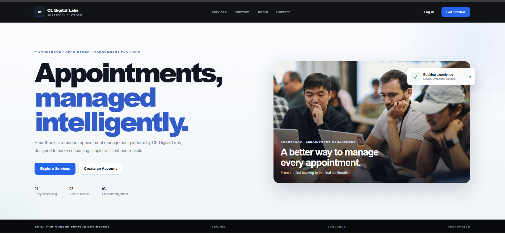

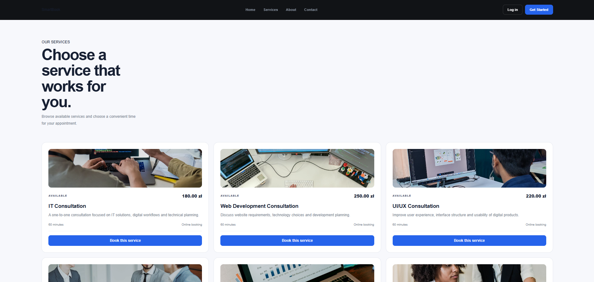

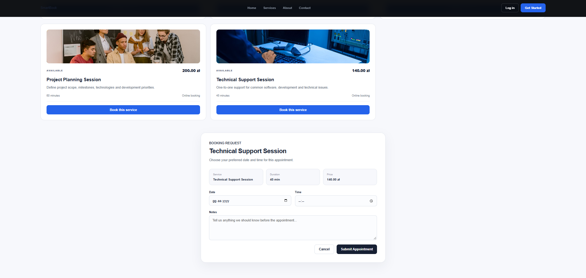

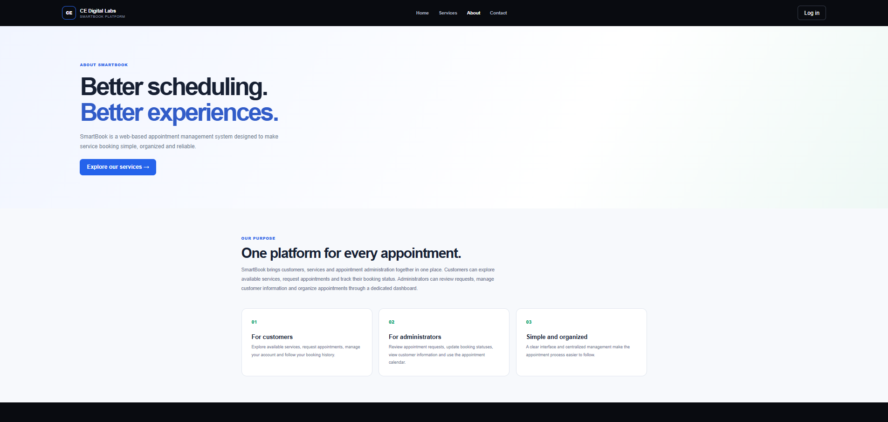

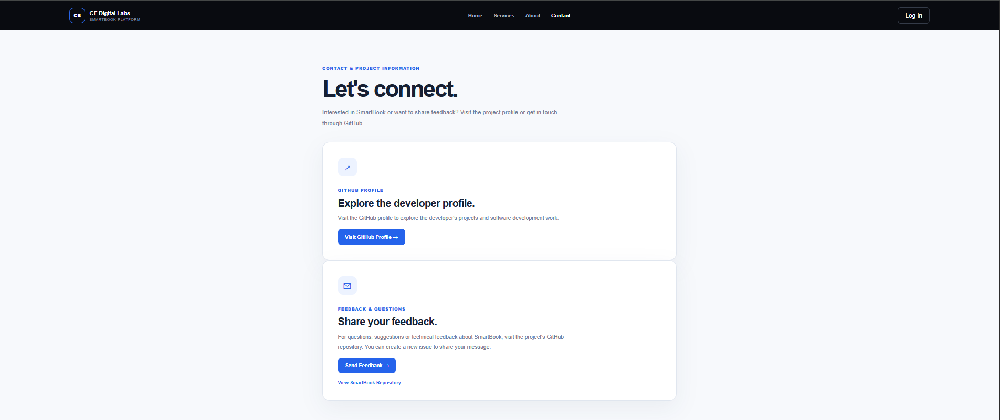

### Customer workspace

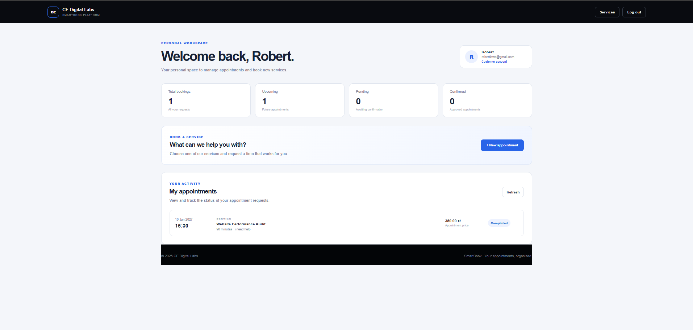

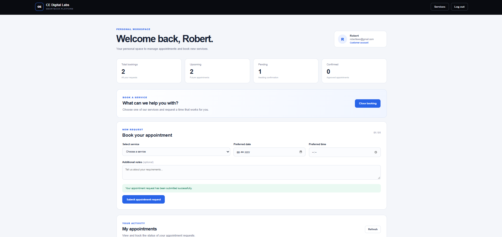

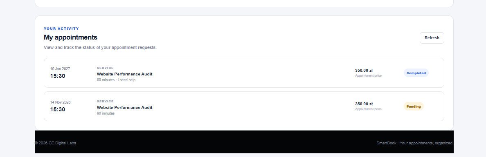

### Administrator workspace

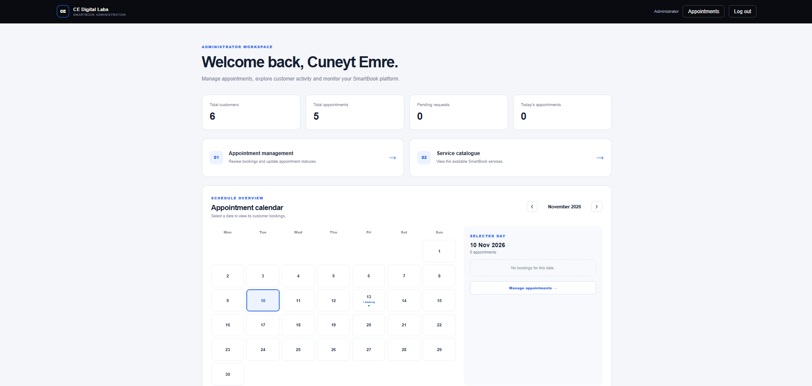

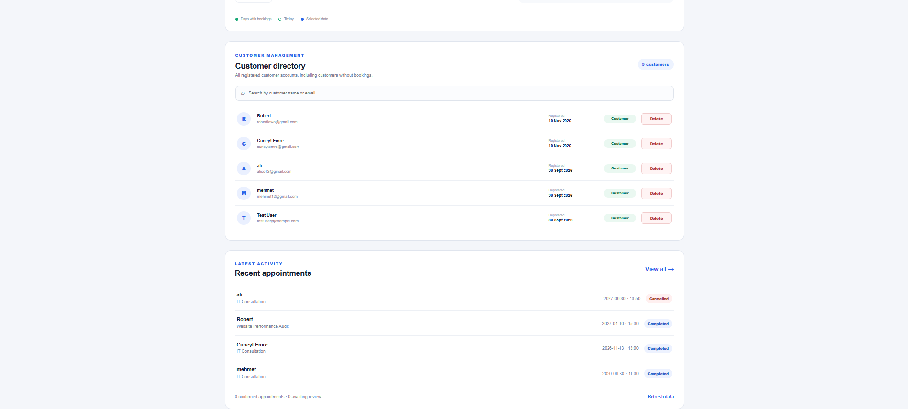

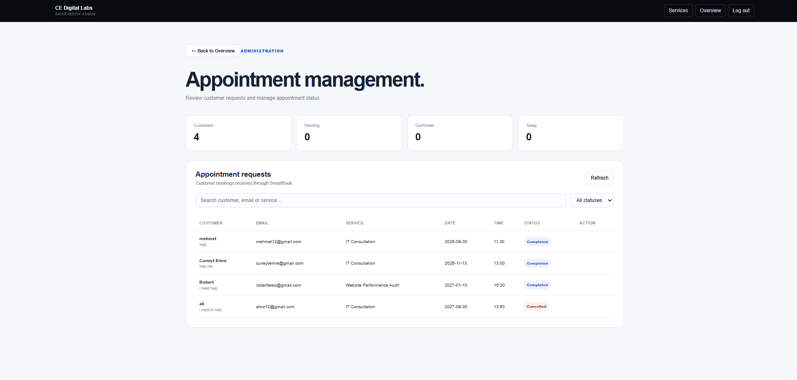

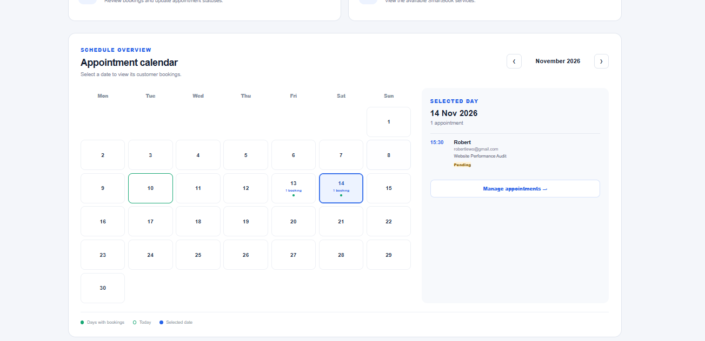

