# SmartBook – Application Screenshots

This folder contains screenshots of the SmartBook web-based appointment management system.

## Public website

### Homepage
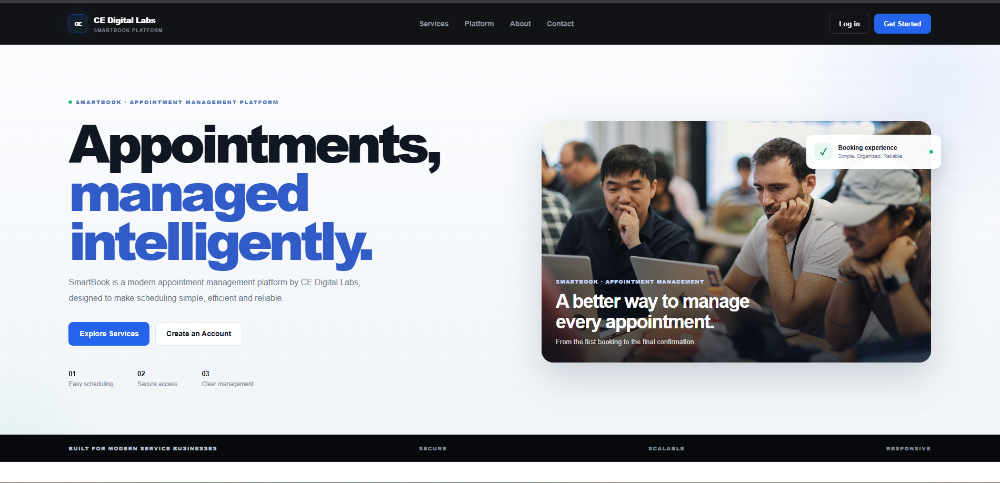

### Platform features
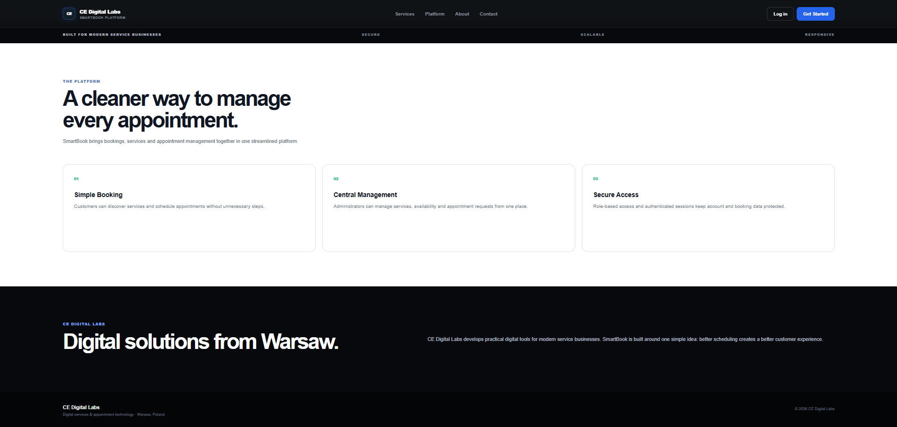

### Services catalogue
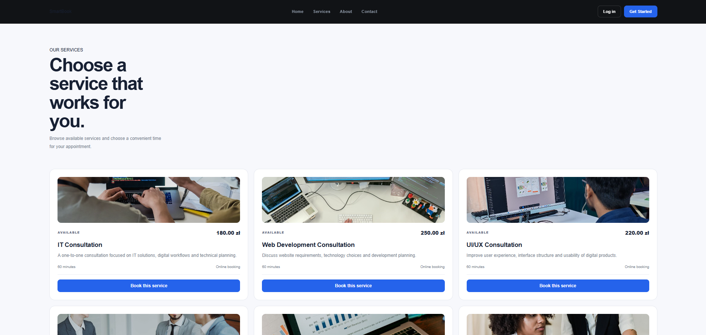

### Service booking form
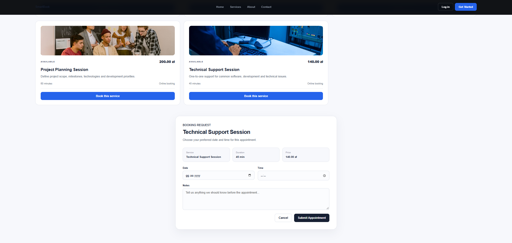

### About page
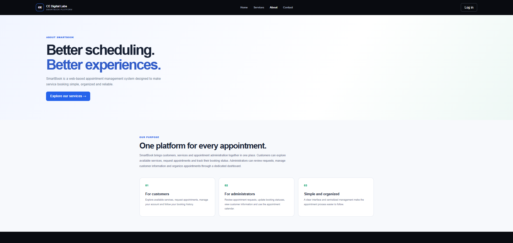

### Contact page
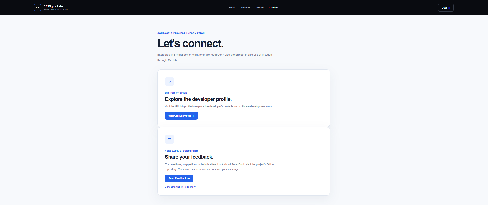

### Login page
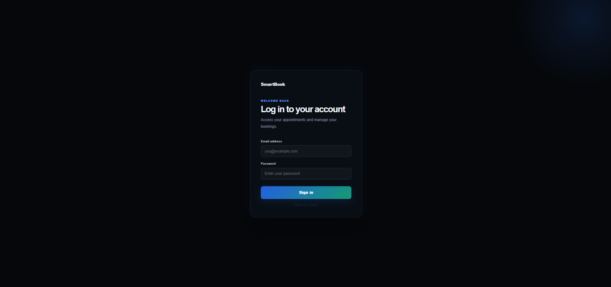

### Registration page
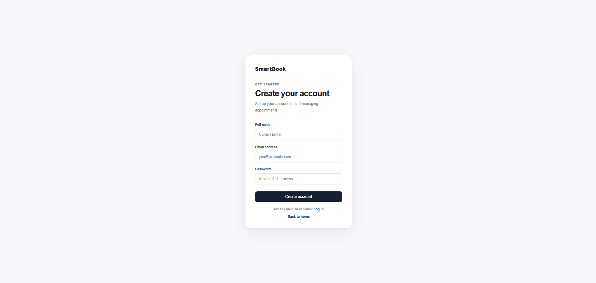

## Customer and administrator workspaces

### Admin dashboard overview
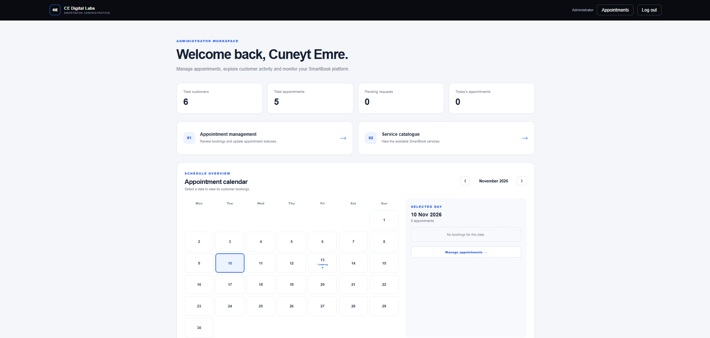

### Admin customer directory
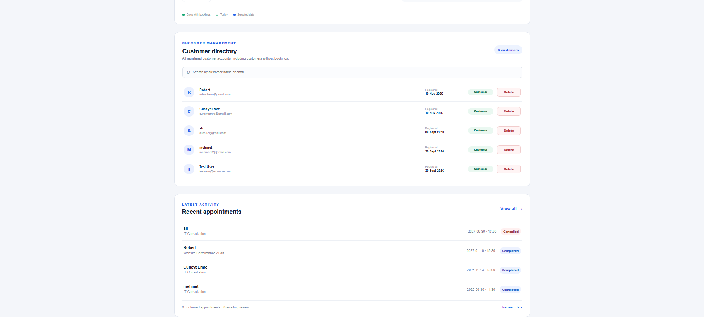

### Admin appointment management
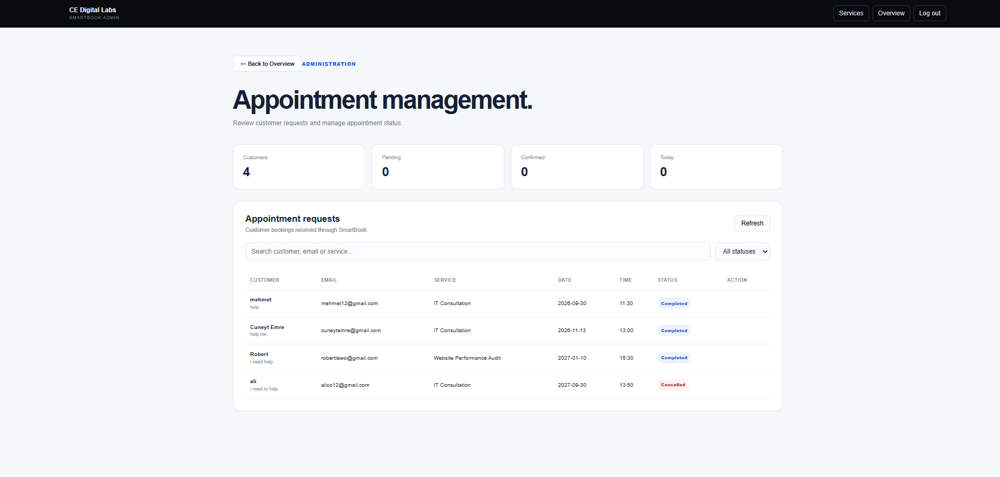

### Customer dashboard
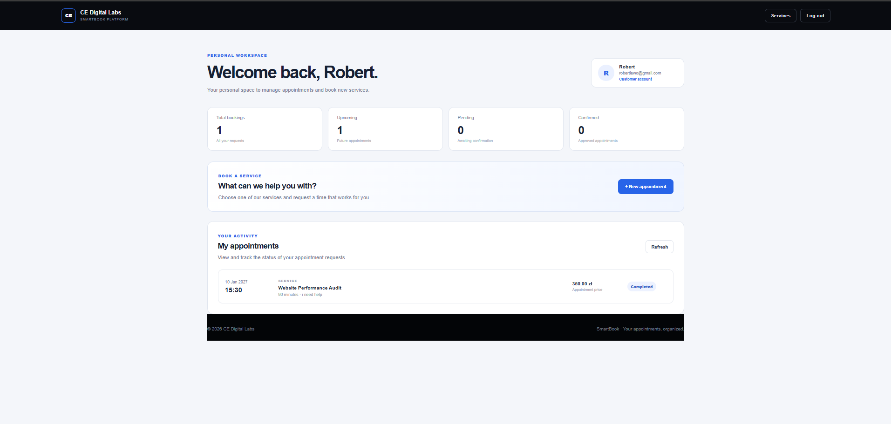

### Customer booking form
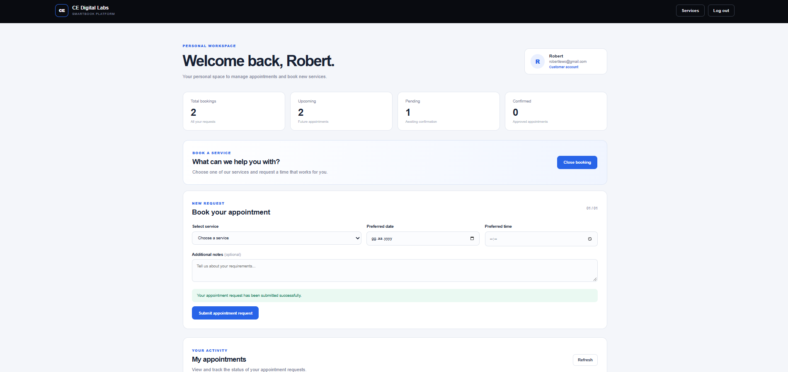

### Customer appointment history
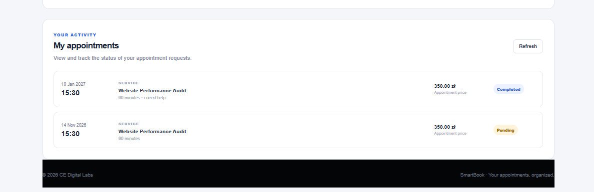

### Admin calendar with selected day
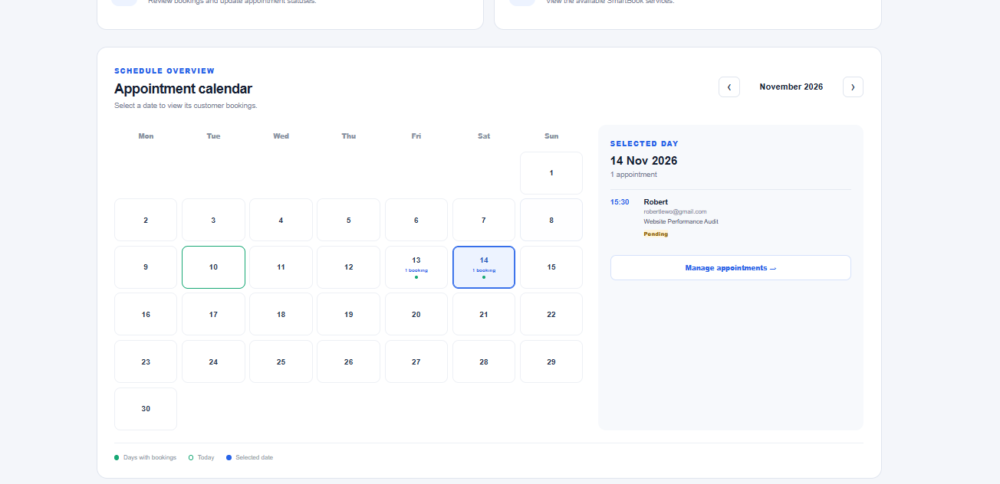

### Admin appointments table
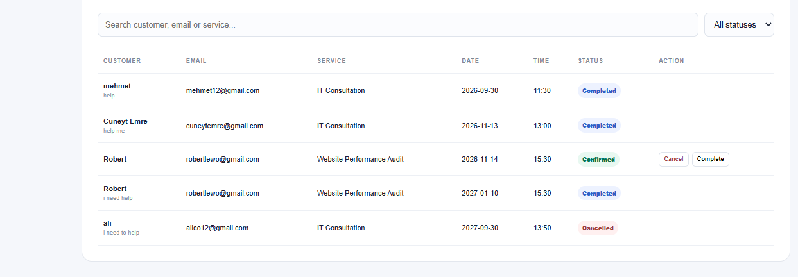
